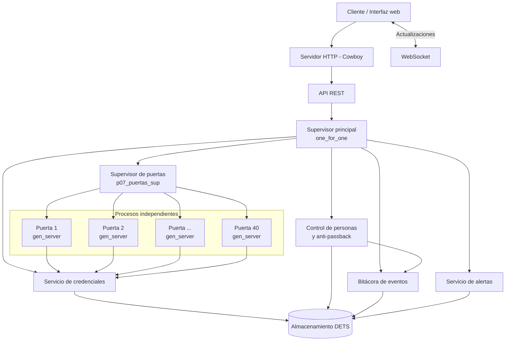
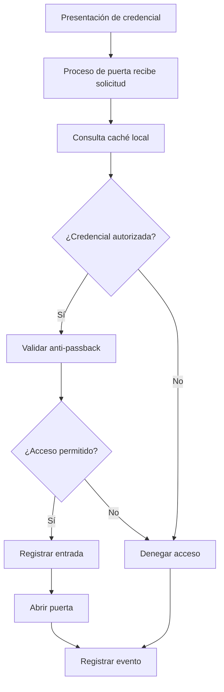

# Sistema de Control de Acceso
### Plataforma distribuida de administración de puertas y credenciales con Erlang/OTP

<p align="center">
  **Proyecto #7 — Erlang/OTP**
  <br>
  Dominio: Ciudad y edificios
</p>

---

## 1. Descripción del proyecto

El Sistema de Control de Acceso es una aplicación distribuida desarrollada con **Erlang/OTP**, diseñada para administrar y supervisar el acceso de personas a edificios mediante credenciales electrónicas y múltiples puntos de entrada.

El sistema utiliza una arquitectura basada en procesos concurrentes, donde cada puerta funciona como un proceso independiente. Esto permite administrar diferentes puntos de acceso de manera simultánea, aislar fallos y mantener la operación de las puertas incluso cuando el servicio central de credenciales no está disponible temporalmente.

La aplicación incorpora mecanismos de validación local, revocación de credenciales, control anti-passback, almacenamiento persistente de eventos, generación de alertas y monitoreo del estado general del sistema.

La comunicación con el sistema se realiza mediante una API HTTP y conexiones WebSocket, utilizando Cowboy como servidor web.

## 2. Objetivos

### 2.1 Objetivo general

Desarrollar un sistema distribuido de control de acceso utilizando Erlang/OTP que permita administrar múltiples puertas y credenciales de manera concurrente, garantizando la continuidad operativa, la recuperación ante fallos y la conservación de los registros de auditoría.

### 2.2 Objetivos específicos

- Implementar un proceso `gen_server` independiente para cada puerta.
- Administrar 40 puertas de acceso de manera concurrente.
- Gestionar un conjunto de más de 2,000 credenciales.
- Implementar validación local para permitir el funcionamiento durante interrupciones del servicio central.
- Desarrollar mecanismos de revocación y distribución de cambios de credenciales.
- Evitar entradas duplicadas mediante un mecanismo anti-passback.
- Mantener una bitácora persistente de eventos.
- Detectar tarjetas robadas e intentos sospechosos.
- Implementar supervisión y recuperación automática de procesos.
- Exponer métricas y herramientas de diagnóstico.
- Generar un release ejecutable y administrarlo mediante systemd.

## 3. Tecnologías utilizadas

| Tecnología | Aplicación |
|---|---|
| Erlang/OTP 27 | Lenguaje y plataforma de concurrencia. |
| Rebar3 | Gestión, compilación y generación del release. |
| Cowboy 2.12.0 | Servidor HTTP y WebSocket. |
| JSX 3.1.0 | Codificación y decodificación JSON. |
| Recon 2.5.6 | Diagnóstico y monitoreo de procesos Erlang. |
| DETS | Persistencia local de información. |
| HTML, CSS y JavaScript | Interfaz web. |
| Stitch | Diseño de las pantallas de la aplicación. |
| Ubuntu / WSL 2 | Entorno de desarrollo y ejecución. |
| systemd | Administración del servicio en producción. |

## 4. Arquitectura del sistema

El sistema utiliza el modelo de concurrencia de Erlang/OTP. Sus componentes se distribuyen en procesos independientes que se comunican mediante mensajes y llamadas entre procesos.

La arquitectura se divide en cuatro áreas principales:

1. **Administración de puertas:** procesos independientes que controlan el estado y las credenciales locales.
2. **Administración central:** servicios encargados de las credenciales, personas dentro del edificio, bitácora y alertas.
3. **Comunicación:** servidor HTTP, API REST y WebSocket.
4. **Supervisión:** supervisores encargados de iniciar y recuperar procesos.

### 4.1 Diagrama general de arquitectura



### 4.2 Procesos principales

| Módulo | Tipo | Responsabilidad |
|---|---|---|
| `p07_puerta` | gen_server | Control individual de una puerta y su caché local de credenciales. |
| `p07_credenciales` | gen_server | Registro, consulta y revocación de credenciales. |
| `p07_personas_dentro` | gen_server | Control de personas dentro del edificio, entradas, salidas y anti-passback. |
| `p07_bitacora` | gen_server | Registro persistente de eventos. |
| `p07_alertas` | gen_server | Detección y almacenamiento de alertas. |
| `p07_http` | worker | Inicio del servidor Cowboy. |
| `p07_ws_handler` | handler | Administración de conexiones WebSocket. |
| `p07_http_handler` | handler | Procesamiento de solicitudes HTTP. |

### 4.3 Supervisión OTP

El proyecto utiliza dos niveles de supervisión:

**Supervisor principal: `p07_control_de_acceso_sup`**

Administra los servicios centrales del sistema:

- Supervisor de puertas.
- Servicio de credenciales.
- Servicio de personas dentro del edificio.
- Servicio de bitácora.
- Servicio de alertas.
- Servidor HTTP.

**Supervisor de puertas: `p07_puertas_sup`**

Administra dinámicamente los procesos correspondientes a las 40 puertas.

Cada puerta tiene una especificación de hijo con reinicio permanente (`permanent`), por lo que el supervisor intenta recuperarla cuando termina inesperadamente.

### 4.4 Estrategia de recuperación

La estrategia utilizada es `one_for_one`.

Esto significa que cuando un proceso falla, el supervisor intenta reiniciar únicamente ese proceso, sin reiniciar automáticamente a todos sus hermanos.

| Componente afectado | Comportamiento esperado |
|---|---|
| Una puerta | Recuperación individual de la puerta. |
| Bitácora | Reinicio del proceso y recuperación de información persistente. |
| Credenciales | Reinicio del servicio central. |
| Supervisor de puertas | Recuperación de su árbol de supervisión. |
| Supervisor principal | Recuperación de los servicios que administra según la estrategia OTP. |

La persistencia mediante DETS permite conservar los registros aunque un proceso tenga que reiniciarse.

## 5. Administración de puertas

Cada puerta se representa mediante un proceso `gen_server` independiente.

Este diseño permite que las puertas procesen operaciones simultáneamente sin depender de un único proceso encargado de todos los accesos.

Cada proceso mantiene información como:

- Identificador de puerta.
- Estado actual.
- Credenciales locales autorizadas.
- Momento de actualización de su información.

Las operaciones principales incluyen:

- Iniciar una puerta.
- Abrir una puerta.
- Cerrar una puerta.
- Consultar su estado.
- Forzar una puerta.
- Sincronizar credenciales.
- Actualizar una credencial individual.
- Validar una credencial localmente.

El sistema administra 40 procesos de puerta identificados numéricamente del 1 al 40.

## 6. Administración de credenciales

El módulo `p07_credenciales` administra el registro y estado de las credenciales.

Las operaciones principales son:

- Registrar una credencial.
- Registrar un lote de credenciales.
- Consultar una credencial.
- Listar las credenciales.
- Revocar una credencial.
- Distribuir los cambios a las puertas disponibles.

La información se almacena utilizando DETS.

### 6.1 Distribución de credenciales

Cuando se registra o modifica una credencial, el sistema distribuye la información correspondiente a los procesos de puerta disponibles.

Cada puerta mantiene una copia local de las credenciales autorizadas para realizar validaciones sin tener que consultar constantemente al servicio central.

### 6.2 Revocación

Cuando una credencial es revocada, se actualiza su estado en el almacenamiento persistente y se distribuye el cambio a las puertas disponibles.

Si una puerta está detenida durante la revocación, al recuperarse carga la información persistente y puede rechazar la credencial revocada.

## 7. Funcionamiento desconectado

Una característica importante del sistema es su capacidad de realizar validaciones utilizando información local.

Cuando el servicio central de credenciales no está disponible, las puertas pueden continuar validando las credenciales que tienen almacenadas en su caché local.

Esto reduce la dependencia de una conexión permanente con el servicio central.

### Flujo de validación local



La validación local fue comprobada suspendiendo temporalmente el proceso central de credenciales y realizando consultas directamente a la caché de una puerta.

**Alcance de la prueba:** se realizó una simulación acelerada de 30 intervalos lógicos de desconexión. No se dejó transcurrir un periodo real de 30 minutos.

## 8. Control anti-passback

El mecanismo anti-passback evita que una misma credencial registre múltiples entradas sin haber registrado previamente una salida.

El módulo `p07_personas_dentro` administra el estado de las personas que se encuentran dentro del edificio.

Cuando se intenta registrar una entrada:

1. Se consulta si la credencial ya se encuentra dentro.
2. Si ya existe un registro activo, el acceso se rechaza.
3. Si no existe, se registra la entrada.
4. Se almacena el evento correspondiente.

El control se realiza desde un proceso coordinador, lo que permite serializar las operaciones y evitar que dos solicitudes concurrentes registren entradas duplicadas.

También se realizaron pruebas de acceso concurrente desde dos puertas diferentes.

## 9. Bitácora y auditoría

El módulo `p07_bitacora` administra el historial de eventos.

Entre los eventos registrados se encuentran:

- Accesos permitidos.
- Accesos denegados.
- Entradas y salidas.
- Revocaciones.
- Alertas.
- Eventos de prueba y recuperación.

La información se almacena en `data/bitacora.dets`.

### 9.1 Protección de eventos pendientes

El módulo `p07_personas_dentro` conserva eventos pendientes de sincronización.

Cuando la bitácora no está disponible temporalmente, los eventos pueden permanecer en la cola local persistente.

Una vez que el servicio se recupera, se realiza la sincronización y se utiliza un mecanismo de registro idempotente para evitar duplicaciones.

Este comportamiento fue comprobado suspendiendo temporalmente la bitácora, registrando un evento y posteriormente verificando su sincronización.

## 10. Detección de tarjetas robadas y alertas

El módulo `p07_alertas` administra la detección de situaciones sospechosas.

Entre sus funcionalidades se encuentran:

- Reportar una tarjeta robada.
- Registrar intentos de utilización.
- Contabilizar intentos dentro de una ventana de tiempo.
- Generar alertas cuando se alcanza el umbral establecido.
- Consultar las alertas registradas.

### 10.1 Detección de intentos sospechosos

El sistema utiliza una ventana de 60 segundos.

Cuando una tarjeta alcanza tres intentos de utilización dentro de esa ventana, se genera una alerta de intentos sospechosos.

Al reportar una tarjeta como robada, el sistema solicita su revocación para impedir su utilización posterior.

## 11. API y comunicación

El sistema utiliza Cowboy para proporcionar comunicación HTTP y WebSocket.

### 11.1 API HTTP

Entre las rutas implementadas se encuentran:

| Método | Endpoint | Descripción |
|---|---|---|
| POST | `/api/accesos` | Procesa un intento de acceso. |
| GET | `/api/bitacora` | Consulta los eventos de auditoría. |
| POST | `/api/tarjetas/robada` | Reporta una tarjeta robada. |
| GET | `/api/alertas` | Consulta las alertas. |
| GET | `/api/diagnostico` | Consulta información de diagnóstico. |
| GET | `/metrics` | Expone métricas del sistema. |
| WebSocket | `/ws` | Proporciona actualizaciones del estado del sistema. |

### 11.2 WebSocket

El endpoint `/ws` permite establecer una conexión WebSocket con el servidor.

El servidor envía actualizaciones periódicas con información general del sistema, como:

- Número de puertas.
- Cantidad de credenciales.
- Personas dentro del edificio.
- Eventos.
- Alertas.
- Marca temporal de actualización.

### 11.3 Métricas Prometheus

El endpoint `/metrics` expone información en formato compatible con Prometheus.

Las métricas implementadas son:

| Métrica | Descripción |
|---|---|
| `control_acceso_puertas_activas` | Cantidad de puertas activas. |
| `control_acceso_credenciales_total` | Total de credenciales registradas. |
| `control_acceso_credenciales_revocadas` | Total de credenciales revocadas. |
| `control_acceso_personas_dentro` | Personas registradas dentro del edificio. |
| `control_acceso_eventos_total` | Total de eventos almacenados. |
| `control_acceso_alertas_total` | Total de alertas registradas. |

### 11.4 Diagnóstico con Recon

El endpoint `/api/diagnostico` utiliza Recon para obtener información de los procesos Erlang.

Se consultan datos como:

- Procesos con mayor consumo de memoria.
- Procesos con colas de mensajes más grandes.
- Memoria utilizada por la máquina virtual.
- Número de procesos activos.
- Límite de procesos configurado.

## 12. Persistencia de información

El sistema utiliza DETS para conservar los datos entre reinicios.

La estructura de almacenamiento es:

```text
data/
├── alertas.dets
├── bitacora.dets
├── credenciales.dets
└── personas_dentro.dets
```

| Archivo | Contenido |
|---|---|
| `alertas.dets` | Información de alertas. |
| `bitacora.dets` | Eventos de auditoría. |
| `credenciales.dets` | Credenciales y sus estados. |
| `personas_dentro.dets` | Personas dentro y eventos pendientes. |

En producción, el directorio `data/` del release se vincula mediante un enlace simbólico al directorio persistente original del proyecto.

De esta manera, el release utiliza los mismos archivos de datos y evita trabajar con una copia independiente.

**Importante:** los archivos DETS contienen información persistente y no deben eliminarse durante una actualización normal del sistema.

## 13. Estructura del proyecto

```text
07-control-de-acceso/
│
├── config/
│   ├── sys.config
│   └── vm.args
│
├── data/
│   ├── alertas.dets
│   ├── bitacora.dets
│   ├── credenciales.dets
│   └── personas_dentro.dets
│
├── design/
│   └── PROMPT_STITCH.md
│
├── priv/
│   └── www/
│       ├── index.html
│       ├── control-de-puertas.html
│       ├── credenciales.html
│       ├── bitacora.html
│       └── alertas.html
│
├── src/
│   ├── p07_acceso.erl
│   ├── p07_alertas.erl
│   ├── p07_bitacora.erl
│   ├── p07_control_de_acceso_app.erl
│   ├── p07_control_de_acceso_sup.erl
│   ├── p07_credenciales.erl
│   ├── p07_http.erl
│   ├── p07_http_handler.erl
│   ├── p07_personas_dentro.erl
│   ├── p07_puerta.erl
│   ├── p07_puertas_sup.erl
│   └── p07_ws_handler.erl
│
├── test/
│   └── p07_control_de_acceso_tests.erl
│
├── rebar.config
└── README.md
```

## 14. Instalación y configuración

### 14.1 Requisitos

- Erlang/OTP 27.
- Rebar3.
- Ubuntu o una distribución Linux compatible.
- Dependencias administradas mediante Rebar3.

### 14.2 Descargar el repositorio

```bash
git clone https://github.com/tectijuana/erlang-proyectos.git
cd erlang-proyectos/proyectos/07-control-de-acceso
```

### 14.3 Compilar el proyecto

```bash
rebar3 compile
```

### 14.4 Ejecutar pruebas

```bash
rebar3 eunit
```

### 14.5 Ejecutar en modo desarrollo

```bash
rebar3 shell
```

La aplicación inicia los servicios principales y crea automáticamente las 40 puertas.

## 15. Release de producción

El proyecto utiliza Rebar3 para generar una versión ejecutable independiente del entorno de desarrollo.

### 15.1 Generar release

```bash
rebar3 compile
rebar3 release
```

El release se genera en:

```text
_build/default/rel/p07_control_de_acceso/
```

### 15.2 Verificar el release

```bash
_build/default/rel/p07_control_de_acceso/bin/p07_control_de_acceso ping
```

La respuesta esperada es:

```text
pong
```

### 15.3 Administración con systemd

Se configuró el servicio:

```text
p07-control-de-acceso.service
```

Comandos principales:

```bash
sudo systemctl start p07-control-de-acceso
sudo systemctl stop p07-control-de-acceso
sudo systemctl restart p07-control-de-acceso
sudo systemctl status p07-control-de-acceso
```

El servicio está habilitado para iniciarse automáticamente mediante systemd.

La configuración de la cookie Erlang se encuentra en `config/vm.args`. Por seguridad, debe utilizarse una cookie privada y segura, sin publicarla en el repositorio.

## 16. Pruebas y validación

Se realizaron pruebas funcionales, de concurrencia, persistencia y recuperación de procesos.

### 16.1 Capacidad del sistema

| Elemento | Resultado comprobado |
|---|---:|
| Puertas | 40 |
| Credenciales registradas | 2,002 |
| Credenciales revocadas | 3 |
| Personas dentro | 290 |
| Eventos de bitácora | 595 |
| Alertas | 2 |

Estos valores corresponden a una medición del sistema durante las pruebas y pueden cambiar con nuevas operaciones.

### 16.2 Prueba de carga

Se realizó una prueba de 150 accesos distribuidos entre 40 procesos de puerta.

| Indicador | Resultado |
|---|---:|
| Intentos procesados | 150 |
| Accesos exitosos | 150 |
| Errores | 0 |
| Timeouts | 0 |
| Tiempo total | 921 ms |

La prueba utilizó trabajadores concurrentes y cerró las puertas después de cada acceso para permitir el siguiente intento.

### 16.3 Prueba de operación desconectada

Se suspendió el proceso central de credenciales y se comprobó que una puerta pudiera validar credenciales mediante su información local.

También se realizaron 1,200 validaciones locales distribuidas en 30 intervalos lógicos simulados, con un tiempo de ejecución de 47 ms.

**Alcance:** se trató de una simulación acelerada; no representa una interrupción real de 30 minutos.

### 16.4 Prueba de revocación durante desconexión

Se detuvo una puerta y se revocó una credencial mientras permanecía fuera de servicio.

Posteriormente se reinició la puerta y se verificó que rechazara la credencial revocada después de recuperar la información persistente.

### 16.5 Prueba de tarjetas robadas

Se reportó una credencial como robada y se realizaron tres intentos de utilización dentro de una ventana de 60 segundos.

El sistema rechazó los intentos y generó una alerta de intentos sospechosos.

### 16.6 Prueba anti-passback

Se realizaron pruebas de entradas duplicadas y accesos concurrentes desde diferentes puertas.

Los resultados confirmaron que el sistema permitió una entrada y rechazó el segundo intento cuando la persona ya estaba registrada dentro del edificio.

### 16.7 Prueba de auditoría

Se suspendió temporalmente el proceso de bitácora, se registró un evento y se comprobó que permaneciera pendiente.

Después de recuperar la bitácora, el evento fue sincronizado y se verificó su presencia en el almacenamiento persistente.

### 16.8 Pruebas de caos

Se inyectaron fallos controlados para comprobar la recuperación de procesos.

| Escenario | Resultado observado |
|---|---|
| Detención controlada de una puerta | Las demás puertas permanecieron disponibles. |
| Terminación inesperada de una puerta | El supervisor inició un nuevo proceso. |
| Terminación inesperada de la bitácora | El supervisor recuperó el proceso y los datos persistieron. |

### 16.9 Pruebas automatizadas

Se ejecutaron las pruebas EUnit disponibles en el proyecto.

Resultado final:

```text
Finished in 0.193 seconds
3 tests, 0 failures
```

Las pruebas automatizadas actuales verifican principalmente el árbol de supervisión. Las pruebas de carga, desconexión, anti-passback y caos descritas anteriormente fueron ejecutadas como pruebas funcionales y manuales.

## 17. Resultados de despliegue

Se generó correctamente el release y se configuró su ejecución mediante systemd.

Durante la validación se comprobó:

- Inicio correcto del release.
- Respuesta `pong` del nodo Erlang.
- Disponibilidad HTTP mediante Cowboy.
- Respuesta HTTP 200 del endpoint `/metrics`.
- Recuperación de las credenciales y eventos persistentes.
- Creación automática de las 40 puertas después del arranque.
- Administración del servicio mediante systemd.

## 18. Limitaciones y trabajo futuro

Aunque se implementaron los componentes principales del sistema, existen oportunidades para ampliar y fortalecer la solución:

- Incrementar la cobertura de pruebas automatizadas EUnit.
- Implementar pruebas de integración automatizadas para todos los endpoints.
- Añadir filtros temporales a la consulta de bitácora.
- Incorporar una sincronización más robusta de cambios de credenciales durante desconexiones prolongadas.
- Implementar pruebas de disponibilidad durante 30 minutos reales.
- Evaluar mecanismos adicionales de replicación y respaldo de los archivos persistentes.
- Integrar un sistema de monitoreo externo con Prometheus y Grafana.
- Fortalecer la autenticación y autorización de los endpoints de administración.

## 19. Conclusiones

El desarrollo permitió implementar un sistema de control de acceso basado en una arquitectura concurrente y distribuida utilizando Erlang/OTP.

La utilización de procesos independientes para cada puerta permite distribuir las operaciones de acceso y aislar los fallos. Asimismo, los supervisores proporcionan mecanismos de recuperación automática, mientras que DETS permite conservar información importante entre reinicios.

Las pruebas realizadas permitieron comprobar el funcionamiento de 40 puertas, la administración de más de 2,000 credenciales, la validación local durante la suspensión del servicio central, el control anti-passback, la detección de tarjetas robadas y la recuperación de procesos.

Finalmente, la generación de un release y su integración con systemd permiten ejecutar la aplicación como un servicio administrado, acercando el proyecto a un entorno de despliegue real.

---

**Proyecto:** Control de Acceso  
**Plataforma:** Erlang/OTP  
**Repositorio:** [tectijuana/erlang-proyectos](https://github.com/tectijuana/erlang-proyectos)
